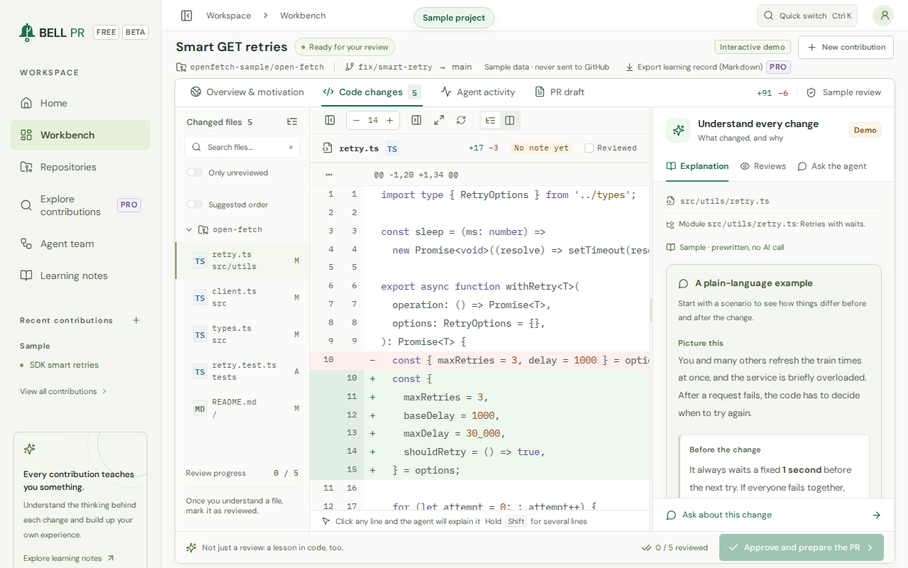

# BELL PR

**From vibe coding to knowing why.**

English · [繁體中文](README.zh-TW.md)

BELL PR is a local workbench for learning through open-source contributions.
It uses your Codex CLI, Claude Code or Antigravity CLI to analyze a project
and build changes in isolated Git worktrees. You review the code with
plain-language explanations, explain what you learned, and approve a
Draft pull request that follows the project's rules.

Free and open source under [Apache-2.0](LICENSE). No BELL PR account or
paid tier; AI usage counts against your own provider account. The interface
and explanations support English and Traditional Chinese; PRs use English
unless the target project asks otherwise.



[Quickstart](#quickstart) · [Requirements](#requirements) ·
[Contribution workflow](#contribution-workflow) · [Development](#development) ·
[Documentation](#documentation)

<!-- generated:product-link key=homepageUrl path=#demo text="Watch the 90-second demo" -->
[Watch the 90-second demo](https://bell-pr.suzu.tw/#demo)
<!-- /generated:product-link -->

## Requirements

Supported on **macOS and Linux**. Windows requires [WSL2](docs/installation.md#windows-with-wsl2)
and all tools installed inside it; this setup has not been tested on a real
Windows host. Browser tests and real agent runs have been verified on Linux.

For real contributions, install:

- **Node.js 22+** ([download](https://nodejs.org/en)). The
  [shell installer](docs/installation.md#shell-installer-macos-and-linux)
  can prepare Node.js 24 if needed.
- **Git**, with `user.name` and `user.email` configured. Syncing a contribution
  onto the latest target branch requires Git 2.40+.
- **GitHub CLI** ([install](https://cli.github.com/)), signed in with `gh auth login`.
- **One AI coding CLI**, installed and signed in as the user running BELL PR:

  | Provider | Install | Sign in |
  | --- | --- | --- |
  | Codex CLI | `npm install -g @openai/codex` | `codex login` |
  | Claude Code | `npm install -g @anthropic-ai/claude-code` | `claude auth login` |
  | Antigravity CLI | `curl -fsSL https://antigravity.google/cli/install.sh \| bash` | Run `agy` |

  BELL PR uses the CLI you installed and signed in to. Claude Code supports
  a Claude plan or an Anthropic API key; usage counts against your own account.
- **For Claude Code on Linux:** `bubblewrap` and `socat`
  (`sudo apt-get install bubblewrap socat` on Debian/Ubuntu).

## Quickstart

```sh
npx bell-pr
```

BELL PR checks your environment, then opens `http://127.0.0.1:4311` in your
browser. In Welcome, choose your language and AI provider, then import a
project or explore contribution ideas. When the AI provider is the only
required check that fails, it still opens. The first time, Welcome shows
how to install one; the tour is on that screen. If another required check
fails, startup stops and prints the commands to fix it.

### Try the sample project

With Node.js installed, you can try the review flow before setting up
GitHub or an AI provider. When the AI provider is the only required check
that fails, `npx bell-pr` still opens. The first time, Welcome shows how
to install one; the sample tour is on that screen. When another required
check fails, start with:

```sh
npx bell-pr start --force
```

Choose **Try the sample project** on Home or **Sample** in the sidebar.
The sample includes a plan, diffs, explanations, an understanding check
and a PR draft. It makes no AI calls and sends nothing to GitHub.
Real agent runs still require a signed-in provider.

To keep BELL PR installed:

```sh
npm install -g bell-pr
bell-pr
```

Other methods, including Homebrew, Bun, mise and the Windows installer,
are in [Installation](docs/installation.md).

## Contribution workflow

1. **Understand the project.** Import a project or discover one on GitHub.
   BELL PR explains its structure, quotes its contribution rules and suggests
   contribution ideas with references to the code.
2. **Plan and build.** Describe the change and approve the Lead's plan.
   Two to four teammates work in separate Git worktrees; a Reviewer and
   Test analyst check the integrated result. In **Learn by hand**, you
   write the code while agents provide guidance and review.
3. **Review and learn.** Read each diff with its explanation, ask about
   unfamiliar code and mark every file reviewed. **Collaborate** lets you
   request fixes or tests on an agent contribution; changed files need
   review again.
4. **Explain and publish.** The understanding check asks you to describe
   the change, answer review questions and state what you did not test.
   Check your answers against references, then approve the PR draft.
   Publishing pushes a branch to your fork when needed and opens a
   **Draft PR** through the GitHub CLI.
5. **Follow up.** Read maintainer feedback and CI results, review follow-up
   fixes and sync with the target branch. Revisit your notes and questions
   on the Learning page, or export your learning record as Markdown.

The understanding check is on by default. Turning it off in **Settings →
Learning** is recorded on the run; file review, approval and the project's
own rules remain required. BELL PR's publishing flow never force-pushes.

Before publishing, BELL PR checks the project's AI policy, issue status,
competing PRs, your outstanding reviews and sensitive content in the change.
Some findings block publication; others require your explanation or confirmation.
See [Contributing responsibly](docs/contributing-responsibly.md) for the rules
and limits, or follow [Getting started](docs/getting-started.md) for a full walkthrough.

## Privacy and security

- **Local storage, external AI.** BELL PR has no cloud service or telemetry.
  Code and prompts read by agents go to your chosen AI provider; GitHub
  operations use your GitHub account. The CLIs have their own data policies.
- **Sandbox limits.** Agents use their CLI's sandbox by default. Import
  only projects whose code you are willing to run. Your Claude Code settings
  [can widen its sandbox](https://code.claude.com/docs/en/sandboxing#configure-sandboxing),
  and GitHub credentials in the system keyring are
  not protected by its file restrictions; use a token with minimal permissions.
  [GitHub documents](https://docs.github.com/en/authentication/keeping-your-account-and-data-secure/managing-your-personal-access-tokens#personal-access-tokens-classic)
  that only classic personal access tokens have write access to public
  repositories that you or your organizations do not own. If publishing fails
  with a fine-grained token, use a classic token.
- **Broader access is optional.** Full access or allowing unsandboxed agents
  gives writable agents your user permissions. Linux's optional passwordless
  sudo grants root access to every process under that user. Use these options
  only in a disposable VM or container.
- **Web access.** Agent web access is off by default, except Antigravity's
  web search, which cannot be disabled. BELL PR also refuses Antigravity
  runs in projects with its hooks, MCP servers, plugins, agents or skills.
- **Private access.** BELL PR listens on `127.0.0.1` by default and requires
  an API credential. For another device, use a private connection and
  `bell-pr pair` as described in [Self-hosting](docs/self-hosting.md).
  Do not expose BELL PR to the public internet. Treat token URLs as passwords;
  `bell-pr token rotate` replaces the install token and revokes all paired devices.

See [Privacy and your data](docs/privacy-and-data.md) and the
[Security model](docs/security-model.md) for provider differences, API
authentication and the limits of these protections.

## Configuration and data

Change language, models, learning options and concurrency in **Settings**.
For ports, environment variables and CLI options, see
[Configuration](docs/configuration.md) and [.env.example](.env.example).

BELL PR stores its projects, worktrees, notes and settings in `~/.bellpr`;
use `--data-dir` or `BELLPR_DATA_DIR` to choose another directory.
To back up, stop BELL PR and copy that whole directory. Restore it to the
same path because records contain absolute paths. See [Upgrading](docs/upgrading.md)
for updates, recovery and version compatibility.

## Development

From a checkout of this repository, use **Node.js 22.13+** and Git:

```sh
npm ci
BELLPR_DATA_DIR=~/.bellpr-dev npm run dev
```

This starts the React interface at `http://127.0.0.1:4310` and the API at
port 4311, using a separate data directory. Real agent runs need the tools
listed in [Requirements](#requirements). Follow the
[development guide](docs/development.md#run-from-source) to authenticate the
browser, run the sample without a provider, or start a built checkout.

| Location | Purpose |
| --- | --- |
| `src/` | React interface and translations |
| `server/` | Local API, CLI and agent orchestration |
| `shared/` | Shared types, logic and product metadata |
| `e2e/` | Browser tests; unit tests live beside the code |

Before submitting changes:

```sh
npm run lint
npm run build
npm test
node scripts/npm-readme.mjs --check-docs
```

Read [CONTRIBUTING.md](CONTRIBUTING.md) and [AGENTS.md](AGENTS.md) for
contribution rules, including DCO sign-off and keeping both languages in step.
[Development](docs/development.md) covers the remaining checks, architecture
and packaging. Participants follow the [Code of Conduct](CODE_OF_CONDUCT.md).

## Documentation

| Need | Guide |
| --- | --- |
| Install or complete a first contribution | [Installation](docs/installation.md) · [Getting started](docs/getting-started.md) |
| Adjust settings or connect BELL products | [Configuration](docs/configuration.md) · [BELL Suite](docs/bell-suite.md) |
| Use another device or run a service | [Self-hosting and pairing](docs/self-hosting.md) · [Docker (beta)](docs/docker.md) |
| Work with other people | [Group work](docs/group-work.md) |
| Fix a problem | [Troubleshooting](docs/troubleshooting.md) · [FAQ](docs/faq.md) |
| Update or restore data | [Upgrading](docs/upgrading.md) · [Changelog](CHANGELOG.md) |

All guides are in the [documentation index](docs/README.md).

<!-- generated:product-link key=docsUrl text="Online documentation" -->
<!-- /generated:product-link -->

## Support

Run `npx bell-pr doctor` to diagnose setup problems, or `npx bell-pr open`
to reopen a running instance. Use the same `--data-dir` if you chose one.
For a support request, **Settings → About → About BELL PR** can copy a
diagnostics report with secrets, paths and your GitHub login removed.
Report vulnerabilities privately as described in [SECURITY.md](SECURITY.md).

<!-- generated:product-link key=homepageUrl text="Website" -->
[Website](https://bell-pr.suzu.tw)
<!-- /generated:product-link -->
<!-- generated:product-link key=publicRepoUrl path=issues text="Report an issue" -->
[Report an issue](https://github.com/Suzu1Dev/bell-pr/issues)
<!-- /generated:product-link -->
<!-- generated:product-link key=supportEmail text="Contact support by e-mail" -->
<!-- /generated:product-link -->
<!-- generated:product-link key=securityEmail text="Report a security issue privately" -->
<!-- /generated:product-link -->

## License and trademarks

[Apache License 2.0](LICENSE); see [NOTICE](NOTICE) and
[third-party notices](THIRD_PARTY_NOTICES.md). The BELL PR name and logo
are covered separately by [TRADEMARKS.md](TRADEMARKS.md).
BELL PR is independent of GitHub, OpenAI, Anthropic and Google; their names
and trademarks identify compatible tools and do not imply endorsement.
