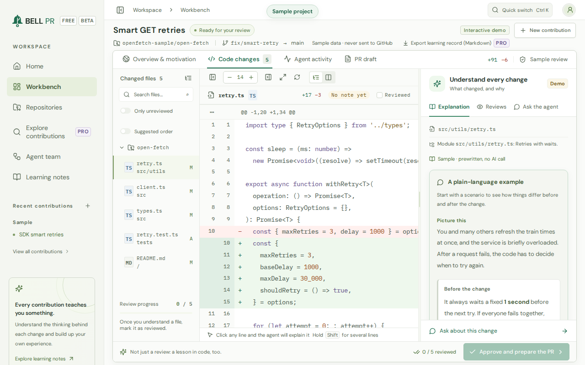
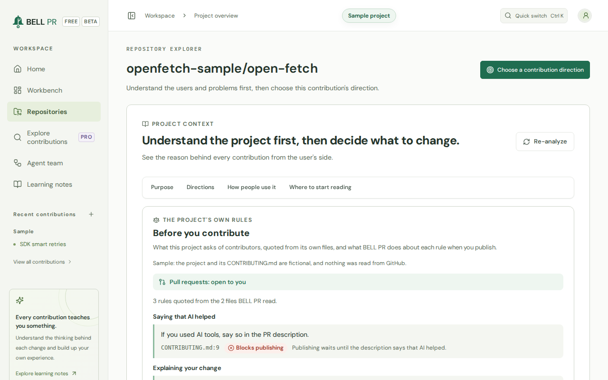
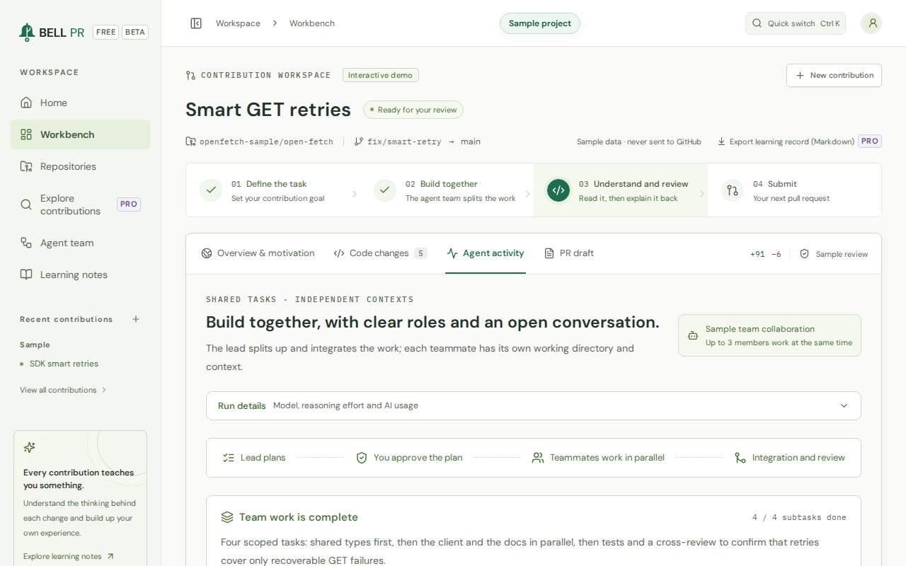
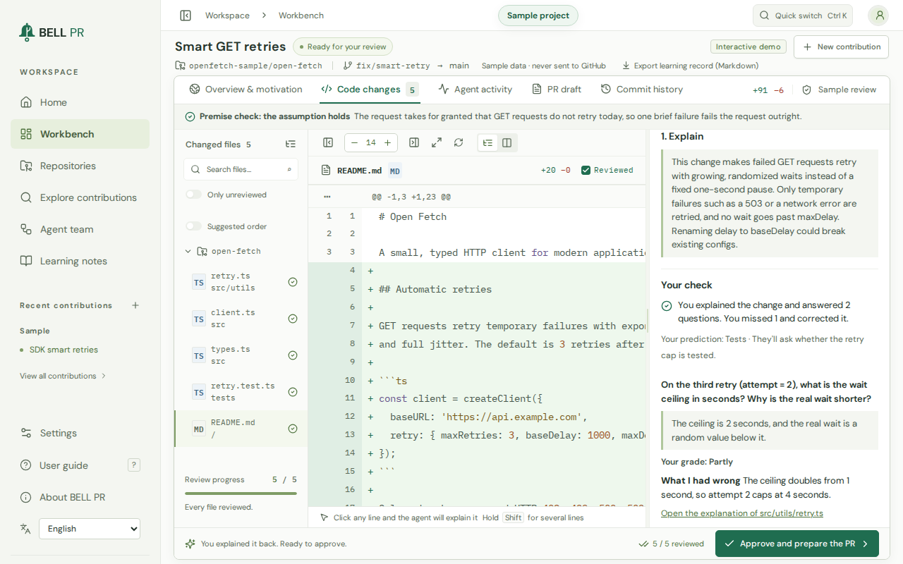
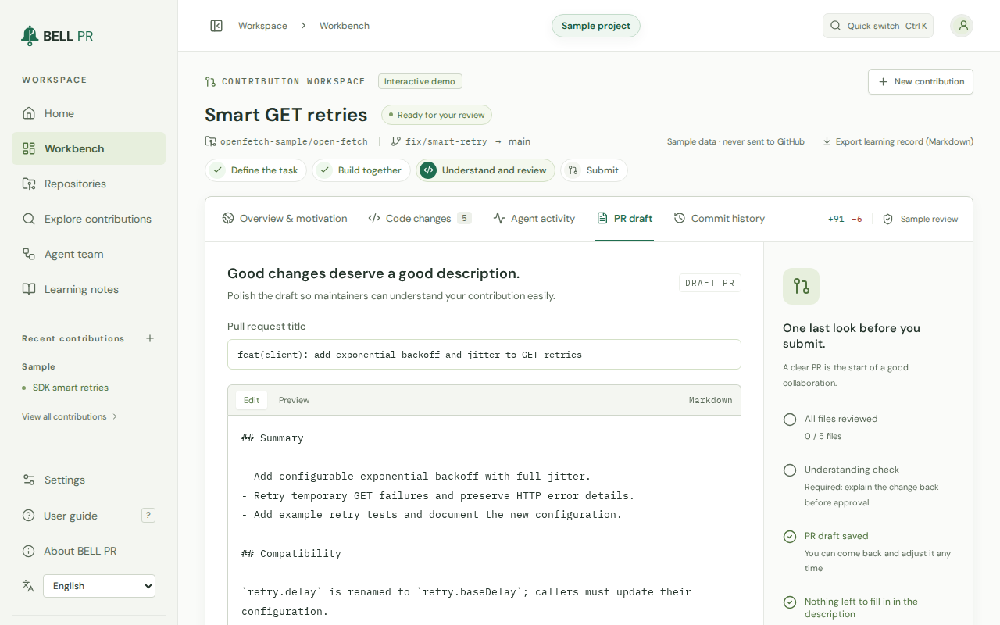
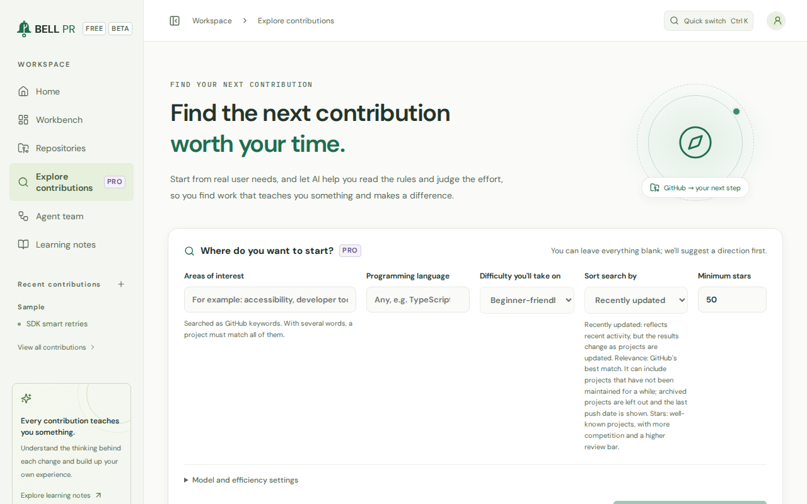
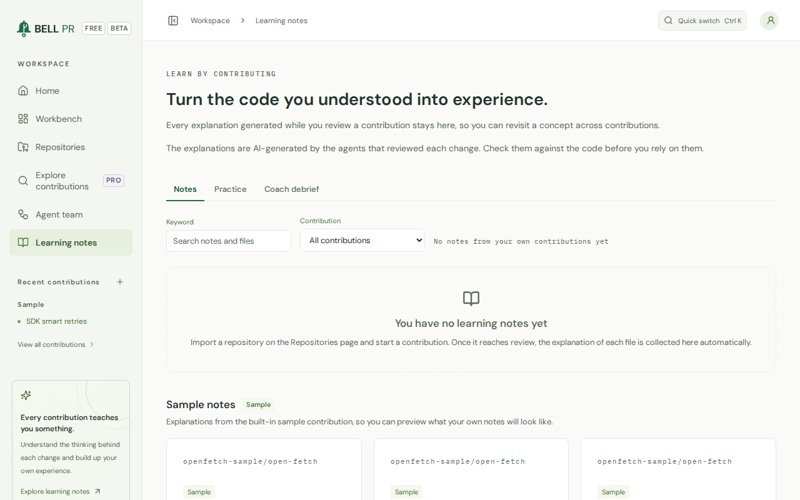

# BELL PR

**From vibe coding to knowing why.**

Your AI agent team does the legwork. You understand every change, explain
it back, and send only what a maintainer is glad to review.

English · [繁體中文](README.zh-TW.md)

BELL PR is a self-hosted, local-first workbench for open-source
contributions. It runs on your computer with the AI coding CLI you already
use (the OpenAI Codex CLI or Claude Code) and the GitHub CLI. It analyzes a
project, suggests where to contribute and lets a small agent team build the
change in isolated Git worktrees. Then it has you do the part that makes
you better: understand every line you send, train your taste on real code,
and respect the maintainers' time. It explains every changed file in plain
language, asks you to explain the change back before you approve it, and
drafts a pull request that follows the project's own rules. Before the
pull request goes out, it checks that the project takes pull requests from
you, that the issue is still open and yours, and that the change is
reviewable and honest about its tests.

**Learn while you contribute, never automatic PRs.** Nothing is published
until you have reviewed every file, explained the change back (on by
default; you can turn it off, and the run says so) and approved the pull
request yourself. Publishing checks that the project welcomes it. There is
no BELL PR cloud, no telemetry and no account.



[Quickstart](#quickstart) · [Requirements](#requirements) ·
[Features](#features) · [Free and Pro](#free-and-pro) ·
[Privacy](#privacy) · [Security](#security-model) ·
[Configuration](#configuration) · [Troubleshooting](#troubleshooting) ·
[Documentation](#documentation)

## Quickstart

With the [requirements](#requirements) in place, this takes about 60
seconds.

1. Start BELL PR:

   ```sh
   npx bell-pr
   ```

2. It prints a sign-in link and opens BELL PR in your browser, signed in:

   ```text
   BELL PR 1.0.0-rc.1 → http://127.0.0.1:4311/auth?t=…
   ```

3. Walk through Welcome: choose your **language**, accept the **license
   agreement**, check your **environment** (every missing tool comes with
   the command that fixes it) and pick the AI **provider** your agents use.
4. Take the sample tour, import a repository, or find a project to
   contribute to.

**Lost the sign-in link? Run `bell-pr open`** (or `npx bell-pr open` if you
started with `npx`). It opens a new one-time link.

To keep BELL PR installed, run `npm install -g bell-pr`, then start it with
`bell-pr`. The [getting started guide](docs/getting-started.md) walks
through a whole contribution.

## Requirements

- **Node.js 22 or later.**
- **Git.** Syncing a run onto the latest target branch needs Git 2.40 or
  later, and commits need your name and e-mail address in Git.
- **The GitHub CLI** (`gh`), signed in with `gh auth login`, to import
  from GitHub, publish pull requests and find projects.
- **The Codex CLI or Claude Code**, installed and signed in as the same
  user that runs BELL PR. One of them is enough.
  - Codex CLI: `npm install -g @openai/codex`, then `codex login`. BELL PR
    uses the Codex CLI you installed and signed in to. Usage counts
    against your own account.
  - Claude Code: `npm install -g @anthropic-ai/claude-code`, then
    `claude auth login`. BELL PR uses the Claude Code CLI you installed and
    signed in to (Claude plan or Anthropic API key). Usage counts against
    your own account.
- **On Linux, bubblewrap and socat** for the sandbox that Claude Code
  agents edit files in (`sudo apt-get install bubblewrap socat`).

`bell-pr doctor` checks all of this and prints the command that fixes each
problem.

## Supported platforms

- **macOS**
- **Linux**
- **Windows through WSL2**: install and run BELL PR, Git, the GitHub CLI
  and your AI CLI inside your WSL distribution.

The 1.0.0-rc.1 release candidate was verified on Linux; macOS and WSL2
verification is pending (see the [changelog](CHANGELOG.md)). A Docker
image is available in beta.

## Features

### Understand the project before you change it

An agent reads the project, read-only, and explains what it does, who uses
it, how its parts fit together and where to start reading. It suggests up
to five contribution directions, each quoting the code or documents it is
based on, and BELL PR checks that every quote really exists. On the same
page, the **Before you contribute** card quotes the project's own
contribution rules (see [Respect the maintainer's
time](#respect-the-maintainers-time)).



### A small agent team, in isolated worktrees

You describe the contribution: who benefits, what changes for them, what
must not change and what counts as done. A **Lead** splits the work into
tasks with clear file scopes, and you can approve or send back the plan.
**Teammates** work in parallel, each in its own Git worktree, and share
findings through a team inbox. They are told to stay inside their file
scopes, to make no formatting-only changes and never to weaken, skip or
delete a test. A **Reviewer** and a **Test analyst** then check the
integrated result, each adding only what the Lead's summary does not say.
Failed subtasks can be retried.

Before it plans, the Lead checks any assumption the request states against
the code, and every role is told the verdict. The brief shows it, and once
the run is finished you can check it again, also on a run made before
these checks. Agents never change your
machine: no `sudo` and no global installs. When a check needs something
the machine lacks, the overview lists it with a suggested command, for you
to verify and run yourself.



### Review that teaches, and checks you learned

Every changed file comes with a plain-language explanation: a concrete
example of the behavior before and after, what changed and why, the
concepts involved, what to check, another way to do it and a question to
test yourself. **Try first**: you answer that question and say how sure
you are before the answer shows, then grade yourself; and you can guess
how else the change could be done before the other way shows, then choose
which one you would take for this project, and why. Click a line to ask
the agent about it, follow the suggested review order, write your own
notes, mark each file reviewed, then explain the change back before you
approve. You can also edit the code yourself and refresh the diff.

The diff opens onto the unchanged code around each change, 20 lines at a
time or the whole file. A **Code walkthrough** explains the functions
around each change step by step, marks their lines in the diff and names
what calls them and what they call; a function the change adds whole
points back to its explanation instead.

**Ship only what you can explain.** Before approval, a short closed-book
check opens next to the diff: explain the change in a few sentences of
your own, answer up to three questions about its riskiest files (none for
a very small change) and, when source code changed, say what you did not
test. Then put each answer beside its AI-written reference, grade it
yourself and correct what you missed. No AI model grades you, and the
check makes no AI call. It is on by default and Free. You can turn it off
under **Settings → Learning**: every file still has to be reviewed, you
still approve the pull request, and runs approved without the check are
marked "Check off" for good.



### Pull requests that follow the project's rules

BELL PR reads the project's contribution guides, AI policies, pull request
template, agent guides and PR-checking workflows, and suggests a title, a
description and a commit message with the source of each rule. Your own
explanation can open the description: **Use my explanation** puts it in
with one click, and **Add my not-tested answer to Testing** adds what you
did not test. While the description is still BELL PR's suggested wording,
publishing asks you to confirm it, and waits if the project asks for
descriptions in the contributor's own words. A snapshot shows how
reviewable the change is, next to the sizes of the project's last merged
pull requests, and a skipped, deleted or loosened test needs a one-line
reason before you publish.

It checks the text before anything is sent: credentials and unfinished
placeholders block it, and a local path, a CI change or a public commit
e-mail address needs your confirmation. AI assistance is mentioned only if
the project requires it or you choose to, and publishing waits until a
disclosure the project requires is there. Publishing pushes a branch (to
your fork when needed) and opens a **Draft** PR through the GitHub CLI;
nothing is ever force-pushed.



### Respect the maintainer's time

Practise anything locally; publish only what is welcome.

- **Before you contribute.** The project overview quotes the project's own
  rules from its files, each with its file and line: what it says about
  AI-assisted contributions, disclosing AI help, descriptions in your own
  words, explaining your change, issues kept for newcomers, notes to AI
  agents and opening an issue first. It also says whether the project
  takes pull requests from you. BELL PR never says that a project has no
  rules, only which files it read.
- **Still open, still yours.** When you link an issue, the task dialog
  shows whether it is still open, whether someone is assigned to it or has
  claimed it, whether someone else's pull request would already close it,
  and what a maintainer last said there. Nothing stops you from starting
  and practising; publishing checks again.
- **Close the loop before the next one.** BELL PR counts your open pull
  requests in the repository. The budget is 1 before your first pull
  request there is merged and 2 after: at the budget, publishing asks you
  to confirm, and so it does when a maintainer has waited more than 7 days
  for you to answer a review there; at twice the budget, it waits until
  you finish or close one. These numbers are BELL PR defaults, the same on
  every plan. Repositories you can write to are not paced, and local runs
  never are.
- **Checked again at publish.** Publishing reads these facts from GitHub
  again. A project that does not take pull requests from you, rules that
  do not accept AI-assisted contributions, a closed issue, an issue the
  project keeps for newcomers, and twice your budget each block it, with
  no override; someone else's open pull request for the same issue blocks
  it until you give your reason. A fact BELL PR could not read shows as
  "Couldn't check", never as a pass.

[Contributing responsibly](docs/contributing-responsibly.md) shows what
maintainers ask for, in their own words, and how each check maps to it.

### After you publish

Sync a run or its pull request onto the latest target branch, with an
agent that can resolve conflicts for your review. **Read feedback** reads
the maintainers' reviews, comments and CI results once, when you ask, on
every plan: compare them with what you predicted, and tag what each
comment raised and whether you saw it coming. With Pro, let an agent
address selected comments in a follow-up round, after you restate each one
in your own words; you review the round and push it as one more commit.
**Commit history** lists every commit of the pull request, from the first
push to review rounds, syncs and commits made on GitHub, each opening to
its files' diffs.

### Find your next contribution (Pro)

Discovery searches GitHub for projects and issues that match your
interests, language and the difficulty you want, reads their contribution
rules, and explains the effort and the first step. It looks for
help-wanted issues for the agent team: an issue labelled for newcomers is
marked "Learn by hand", because writing that fix yourself is how a
newcomer learns the project. Free shows labelled sample results.



### Learning page and practice

Every explanation and note from every contribution is collected on one
page, with a search, so you can come back to a concept later.
**Practice** brings your own questions back after 1, 3, 7 and 21 days:
answers you missed while you were sure, maintainer comments that surprised
you and questions you never tried. Plain counts from your records, such as
how often you were right when you said "Sure", appear once there is enough
to count, and none of them is a score or a goal. With Pro, a **coach
debrief** reads your records for one project, names what its maintainers
raise most and builds practice drills from your own contributions, and you
can export a contribution's complete learning record as Markdown.



### Your tools, your accounts, your language

Choose the Codex CLI or Claude Code, the model and the reasoning effort,
and an efficiency mode (Lean, Full or Off). Each run shows the usage the
provider reported. When a CLI fails, the error it reported shows first and
its raw output folds away. The interface and the agents' explanations are in
English or Traditional Chinese (Taiwan); pull requests stay in English
unless the project asks otherwise.

### Try it with the sample project

A finished sample contribution, with the project's rules, the plan, the
changes, their explanations, the understanding check and the PR draft,
needs no setup and makes no AI call. It also shows the Pro features with
sample data.

## Free and Pro

<!-- generated:plan-table locale=en -->

| Feature | Plan | Limits |
| --- | --- | --- |
| Repositories and contribution runs | Free | Unlimited repositories and runs |
| Project analysis with verified recommendations | Free | Up to 5 recommendations per analysis; re-analysis is allowed. Recommendations you already generated (up to 30) stay visible after a downgrade. |
| More recommendations ("Generate 5 more", up to 30 per project) | Pro | Free: 5. Pro: up to 30 per project. |
| Agent team size | Free (limited) | Free: Lead, 2 teammates, Reviewer and Test analyst. Pro and trial: 3 or 4 teammates. |
| Work on more than one contribution at a time | Free (limited) | Free: one contribution at a time; others wait in the queue. Pro: up to your configured limit (2 by default, at most 8). Publishing is paced the same on every plan. |
| Plan approval and revision, team inbox, retry of failed subtasks | Free | Up to 3 plan revisions |
| Diff review, explanations, try-first questions, follow-up chat, notes, suggested review order | Free | No limit |
| Explain it back before approval | Free | On by default; you can turn it off in Settings → Learning, and runs approved without it are marked |
| Re-run Reviewer and Test analyst | Free | No limit (part of the human review safety gate) |
| Rule-aware PR draft, preflight checks, publishing a Draft PR | Free | Human approval is required on every plan |
| Project-rule, issue, reviewability and pacing checks | Free | On every plan; no plan can skip them |
| Syncing a run onto the latest target branch, agent conflict resolution, updating a project's local clone | Free | No limit (unpublished runs and published PRs) |
| Learning notes page | Free | No limit |
| Practice deck and learning counts | Free | No limit |
| Complete learning record export (Markdown) | Pro | Free: not available (the learning page stays Free) |
| Coach debrief from your own records | Pro | Free: not available; the sample project shows an example labelled PRO. Debriefs you already have stay readable after a downgrade. |
| Read maintainer feedback and compare it with your forecast | Free | No limit |
| AI follow-up rounds on maintainer feedback | Pro | Free: not available. Follow-up rounds already on a run stay readable after a downgrade, and an open round can still be reviewed, pushed, stopped or discarded. |
| Discovery (GitHub-wide recommendations) | Pro | Free: labelled sample results only. Results you already have stay readable, and a running discovery can still be cancelled. |
| Web access for agents | Pro | Free: off. Pro: off until you turn it on. Claude Code may then open pages on GitHub's own sites only; the Codex CLI uses OpenAI's web search. |
| Deep reasoning efforts (xhigh, max, ultra) | Pro | Free: choose none to high. Leaving the effort on "Default" uses the model's own default effort on every plan. |
| Providers, model choice, Efficiency modes | Free | Codex CLI and Claude Code, all models, all efficiency modes |
| Sample project / demo (Pro features shown with sample data) | Free | Sample data in your browser only |
| 14-day Pro trial | Free | One per data directory, started only when you choose (in the app or with bell-pr license trial) |
| Pro license term and updates | Pro | Per named user; perpetual, with 12 months of updates from the date your key is issued |

<!-- /generated:plan-table -->

Free covers the whole responsible loop. Pro goes deeper: a coach debrief,
the complete learning record, AI follow-up rounds, bigger teams, more than
one contribution at a time, discovery, web access and deep reasoning. No
plan buys more pull requests or a way past a check.

Every data directory can try Pro for 14 days: **Settings → License → Start
14-day trial**, or `bell-pr license trial`. Moving back to Free never takes
away runs, notes or results you already have. See
[Licensing](docs/licensing.md).

<!-- generated:product-link key=pricingUrl text="Pricing" -->
<!-- /generated:product-link -->
<!-- generated:product-link key=purchaseUrl text="Buy Pro" -->
<!-- /generated:product-link -->

## Privacy

- BELL PR runs on your computer and keeps everything in one data
  directory. There is no BELL PR cloud, account, telemetry, analytics or
  license server.
- Your code and your questions go only to the services you set up: the
  provider of the AI CLI you chose, and GitHub, under your own accounts.
- Web access for agents is off unless you turn it on (Pro).
- In the app you can free a run's files, delete a run or a project, or
  delete all data.

Details: [Privacy and your data](docs/privacy-and-data.md) and the privacy
policy in [PRIVACY.md](PRIVACY.md).

## Security model

- **Sandboxed agents.** Agents that write code run in their CLI's
  operating-system sandbox: writes stay in the run's own worktree and the
  network is closed. Claude Code agents are also denied your SSH keys, the
  GitHub CLI's sign-in and BELL PR's own data; Codex's sandbox does not
  limit reading.
- **Imported projects are untrusted.** Their code, documents and agent
  instructions (`AGENTS.md`, `CLAUDE.md`, `.claude/`) are treated as data:
  the CLIs never load the project's own settings, hooks or instructions,
  and a repository whose Git configuration could run programs is refused.
  Agents still run the project's code, so import only projects you are
  willing to run on this computer.
- **Session sign-in.** BELL PR listens on `127.0.0.1` and accepts a browser
  only after it opened a sign-in link. The session secret lives in memory,
  so a restart signs everyone out. Requests from other sites are refused.
- **Unsandboxed agents are an explicit opt-in.** Without the sandbox (for
  example in Docker with default settings), a Claude Code agent that edits
  files is refused. You can allow it under **Settings → Agent safety** or
  with `BELLPR_ALLOW_UNSANDBOXED_AGENTS=1`; such agents have your full user
  rights, and every run that used one carries a **Ran without sandbox**
  badge.
- **You publish.** Nothing reaches GitHub before your file-by-file review
  and approval, and the commit holds only the files you reviewed.

Details and limits: [Security model](docs/security-model.md). To report a
vulnerability, see [SECURITY.md](SECURITY.md).

## Configuration

BELL PR needs no configuration. Every setting below is an environment
variable read at start; `bell-pr start` also takes `--port`, `--host`,
`--data-dir`, `--no-open` and `--env-file <file>`. Values set in the app's
Settings are used unless a variable sets them.

| Variable | Default | What it sets |
| --- | --- | --- |
| `BELLPR_PORT` | `4311` | Port of the web interface and the API (1024 to 65535) |
| `BELLPR_HOST` | `127.0.0.1` | Address to listen on; to reach BELL PR from other machines, keep it and add an HTTPS reverse proxy with `BELLPR_PUBLIC_URL` |
| `BELLPR_PUBLIC_URL` | none | The address browsers use behind a reverse proxy or another published port |
| `BELLPR_ALLOWED_ORIGINS` | none | Extra exact origins to accept, comma-separated |
| `BELLPR_DATA_DIR` | `~/.bellpr` | The data directory |
| `BELLPR_NO_OPEN` | not set | `1` never opens a browser |
| `BELLPR_LOCALE` | `en` | Default language of server and CLI messages (`en` or `zh-TW`) |
| `BELLPR_LOG_LEVEL` | `info` | `debug`, `info`, `warn` or `error` |
| `BELLPR_LICENSE_KEY` | none | A Pro license key; wins over a saved key |
| `BELLPR_MAX_AGENT_PROCESSES` | `3` | Agent CLI processes at the same time (1 to 32) |
| `BELLPR_MAX_ACTIVE_RUNS` | `2` | Runs executing at the same time (1 to 8; Free runs one) |
| `BELLPR_AGENT_TIMEOUT_SCALE` | `1` | Multiplier for agent time limits (0.5 to 10) |
| `BELLPR_ALLOW_UNSANDBOXED_AGENTS` | not set | `1` lets Claude Code agents edit files without the sandbox |
| `BELLPR_REQUIRE_UNDERSTANDING_CHECK` | not set | `1` keeps the understanding check on and locks the setting; no value turns it off |
| `BELLPR_RETENTION_DAYS` | `14` | Days before the files of cancelled and failed runs are removed (1 to 365) |
| `BELLPR_DEV` | not set | Development mode, for working on BELL PR itself |
| `BELLPR_FRONTEND_PORT` | `4310` | Port of the dev server that development mode trusts |
| `BELLPR_STATIC_DIR` | the package's `dist/` | The built web interface to serve |

[Configuration](docs/configuration.md) explains each one, the commands and
the app's settings; [.env.example](.env.example) is a commented template.
Variables used only by BELL PR's own tests are in
[Development](docs/development.md#test-and-tool-variables).

## Docker (beta)

```sh
docker build -t bell-pr .
docker run -d --name bell-pr -p 127.0.0.1:4311:4311 \
  -v bellpr-data:/data -v bellpr-home:/home/node bell-pr
docker exec bell-pr bell-pr open --print
```

The image includes Git, the GitHub CLI and the Codex CLI; you can install
Claude Code into the container yourself. Docker is **beta**: the agent
sandbox needs three extra `--security-opt` options. Read
[Docker](docs/docker.md) before you use it, and
[Self-hosting](docs/self-hosting.md) for a systemd service or a reverse
proxy.

## Troubleshooting

```sh
bell-pr doctor
```

checks Node.js, Git, the GitHub CLI and its permissions, the agent CLIs and
their sign-ins, the Claude Code sandbox and the data directory, and prints
the command that fixes each problem. `bell-pr doctor --json` gives the same
report as JSON. It exits with 0 when every required check passes.

[Troubleshooting](docs/troubleshooting.md) lists [every error
code](docs/troubleshooting.md#error-codes) with its fix, explains
[why BELL PR blocked
publishing](docs/troubleshooting.md#publishing-was-blocked-by-a-project-rule-an-issue-or-pacing),
and says what to do when BELL PR does not start and how to collect details
for a support request.

## Data directory and backups

BELL PR keeps everything in `~/.bellpr` (or `--data-dir` /
`BELLPR_DATA_DIR`): your projects and runs in `state.json`, its own clones
of the projects, a Git worktree per run, analyses, settings, the license
and logs. It is readable by your user only.

- **Back up** by stopping BELL PR and copying the whole directory. Restore
  it to the same path: its records contain absolute paths.
- BELL PR keeps the last three versions of `state.json` and recovers from a
  damaged file by itself.
- One BELL PR runs per data directory at a time.
- **Upgrading** never moves your data, and from 1.0.0 on an older version
  can still read what a newer one wrote. See [Upgrading](docs/upgrading.md),
  including data from versions before 1.0.

## Licensing and activation

Pro is unlocked by a license key that BELL PR checks offline. Activate it
in any of three ways:

- **In the app:** **Settings → License**, paste the key, **Activate**.
- **On the command line:** `bell-pr license activate <key>`, or
  `bell-pr license activate -` to read it from standard input.
  `bell-pr license status` shows the plan; `deactivate` removes the key;
  `trial` starts the 14-day trial.
- **With the environment:** `BELLPR_LICENSE_KEY=<key>`; it wins over a
  saved key.

A key covers the builds released within its update period (12 months of
updates from the date your key is issued, by default) and keeps working
with them forever. In this release candidate no license key can unlock Pro
yet; the trial works. See [Licensing](docs/licensing.md).

## Documentation

- [Getting started](docs/getting-started.md)
- [Configuration](docs/configuration.md)
- [Troubleshooting](docs/troubleshooting.md)
- [Licensing](docs/licensing.md)
- [Contributing responsibly](docs/contributing-responsibly.md)
- [Privacy and your data](docs/privacy-and-data.md)
- [Upgrading](docs/upgrading.md)
- [FAQ](docs/faq.md)
- [Self-hosting](docs/self-hosting.md) and [Docker](docs/docker.md)
- [Security model](docs/security-model.md)
- [Development](docs/development.md): building and checking BELL PR from
  its source
- [Changelog](CHANGELOG.md)

<!-- generated:product-link key=docsUrl text="Online documentation" -->
<!-- /generated:product-link -->

## Support and contact

Start with `bell-pr doctor` and [Troubleshooting](docs/troubleshooting.md).
The About dialog (**Settings → About → About BELL PR**) can copy a
diagnostics report with secrets, paths and your GitHub login removed, ready
for a support request.

<!-- generated:product-link key=homepageUrl text="Website" -->
<!-- /generated:product-link -->
<!-- generated:product-link key=supportEmail text="Contact support by e-mail" -->
<!-- /generated:product-link -->
<!-- generated:product-link key=publicRepoUrl path=issues text="Report an issue" -->
<!-- /generated:product-link -->
<!-- generated:product-link key=securityEmail text="Report a security issue privately" -->
<!-- /generated:product-link -->

## License and trademarks

BELL PR is licensed under the End User License Agreement in
[LICENSE.md](LICENSE.md). The third-party software it includes is listed
in [THIRD_PARTY_NOTICES.md](THIRD_PARTY_NOTICES.md). The legal documents of
this release candidate are drafts pending counsel review.

BELL PR is an independent product and is not affiliated with, endorsed by,
or sponsored by GitHub, Inc., OpenAI, or Anthropic PBC. GitHub, OpenAI,
Codex, Anthropic, Claude and Claude Code are trademarks of their
respective owners; BELL PR names them only to say which tools it works
with.
