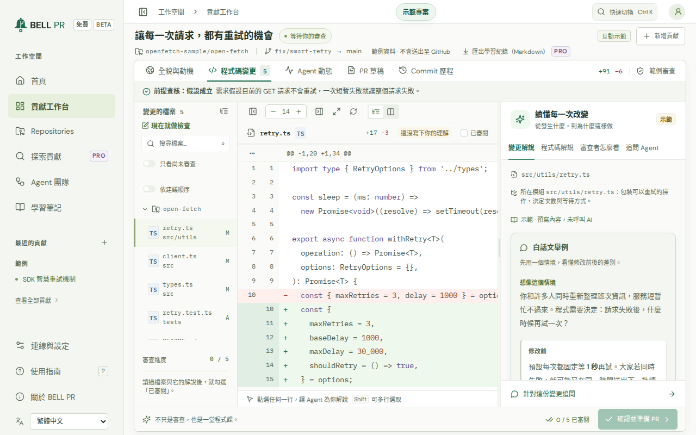

# BELL PR

**從「憑感覺寫」到「知道為什麼」。**

[English](README.md) · 繁體中文

BELL PR 是讓你透過開源貢獻學習的本機工作台。它使用你的 Codex CLI、Claude Code 或 Antigravity CLI 分析專案，在獨立的 Git worktree 中完成修改。你透過白話解說審閱程式碼、用自己的話說明改動，再核准符合專案規範的 Draft Pull Request。

以 [Apache-2.0](LICENSE) 授權，免費開源，不需 BELL PR 帳號，也沒有付費版；AI 用量計入你自己的服務商帳戶。介面與解說支援英文和繁體中文；除非目標專案另有要求，PR 使用英文。



[快速開始](#快速開始) · [系統需求](#系統需求) · [貢獻流程](#貢獻流程) · [開發](#開發) · [文件](#文件)

<!-- generated:product-link key=homepageUrl path=zh-tw/#demo text="觀看 90 秒示範" -->
[觀看 90 秒示範](https://bell-pr.suzu.tw/zh-tw/#demo)
<!-- /generated:product-link -->

## 系統需求

支援 **macOS 與 Linux**。Windows 需使用 [WSL2](docs/installation.md#windows-with-wsl2)，並將所有工具裝在 WSL 內；此流程尚未在真實 Windows 主機測試。瀏覽器測試與真實 Agent 執行已在 Linux 驗證。

進行實際貢獻前，請準備：

- **Node.js 22 以上**（[下載](https://nodejs.org/en)）。[Shell 安裝腳本](docs/installation.md#shell-installer-macos-and-linux)可在需要時準備 Node.js 24。
- **Git**，並設定 `user.name` 與 `user.email`。同步到最新目標分支需 Git 2.40 以上。
- **GitHub CLI**（[安裝](https://cli.github.com/)），以 `gh auth login` 登入。
- **一套 AI 程式設計 CLI**，以執行 BELL PR 的同一使用者安裝並登入：

  | 服務 | 安裝 | 登入 |
  | --- | --- | --- |
  | Codex CLI | `npm install -g @openai/codex` | `codex login` |
  | Claude Code | `npm install -g @anthropic-ai/claude-code` | `claude auth login` |
  | Antigravity CLI | `curl -fsSL https://antigravity.google/cli/install.sh \| bash` | 執行 `agy` |

  BELL PR 使用你已安裝並登入的 CLI。Claude Code 可使用 Claude 方案或 Anthropic API 金鑰；用量計入你自己的帳戶。
- **Linux 使用 Claude Code 時**另需 `bubblewrap` 與 `socat`（Debian/Ubuntu：`sudo apt-get install bubblewrap socat`）。

## 快速開始

```sh
npx bell-pr
```

BELL PR 會檢查環境，再於瀏覽器開啟 `http://127.0.0.1:4311`。依歡迎畫面選擇語言與 AI 服務，接著匯入專案或探索貢獻方向。必要檢查未通過時，啟動會停止並列出修正指令。

### 用範例專案試試看

只要已安裝 Node.js，就能在設定 GitHub 或 AI 服務前體驗審閱流程：

```sh
npx bell-pr start --force
```

從首頁「試用範例專案」或側欄「範例」開啟。範例包含計畫、diff、解說、理解檢查與 PR 草稿，不呼叫 AI，也不會送到 GitHub。真實的 Agent 工作仍需已登入的 AI 服務。

若要保留安裝：

```sh
npm install -g bell-pr
bell-pr
```

Homebrew、Bun、mise 與 Windows 安裝腳本等方式，請見[安裝指南](docs/installation.md)。

## 貢獻流程

1. **理解專案。** 匯入 Repository，或從 GitHub 探索專案。BELL PR 說明專案結構、引用貢獻規範，並提出有程式碼依據的貢獻方向。
2. **規劃與實作。** 描述改動並核准 Lead 的計畫。兩到四位隊友各自在獨立的 Git worktree 工作，再由 Reviewer 與 Test analyst 檢查整合結果。選擇「親手學」時，由你寫程式，Agent 提供引導與審查。
3. **審閱與學習。** 對照 diff 與解說、詢問不熟悉的程式碼，逐檔標記已審閱。Agent 貢獻可透過「協作」要求修正或補測試；改動後的檔案需要重新審閱。
4. **說明與發佈。** 理解檢查請你說明改動、回答審閱問題，並交代沒測試的部分。對照參考答案後，再核准 PR 草稿。發佈會推送分支（必要時使用你的 fork），並透過 GitHub CLI 開啟 **Draft PR**。
5. **跟進與複習。** 讀取維護者回饋與 CI 結果、審閱後續修正，並同步目標分支。在學習頁回顧筆記與題目，也能將學習紀錄匯出為 Markdown。

理解檢查預設開啟。在「設定 → 學習」關閉時，工作會留下標記；逐檔審閱、親自核准與專案規範仍然必要。BELL PR 的發佈流程不會 force push。

發佈前會檢查專案的 AI 政策、issue 狀態、其他人的 PR、你尚待回覆的審查，以及改動中的敏感內容。部分結果會阻擋發佈，其他結果需要你說明或確認。規則與限制請見[負責任地貢獻](docs/contributing-responsibly.md)；完整操作流程請見[入門指南](docs/getting-started.md)。

## 隱私與安全

- **本機儲存，外部 AI。** BELL PR 沒有雲端服務或遙測。Agent 讀取的程式碼與提問會送到你選擇的 AI 服務商；GitHub 操作使用你的帳戶。各 CLI 另有自己的資料政策。
- **沙箱的限制。** Agent 預設使用各 CLI 的沙箱。請只匯入你願意在這台電腦上執行的專案。你的 Claude Code 設定[可能放寬沙箱](https://code.claude.com/docs/en/sandboxing#configure-sandboxing)，系統 keyring 中的 GitHub 憑證也不受其檔案限制保護；請使用權限最小的 token。[GitHub 的文件說明](https://docs.github.com/en/authentication/keeping-your-account-and-data-secure/managing-your-personal-access-tokens#personal-access-tokens-classic)，只有 classic personal access token 能寫入不屬於你、也不屬於你所屬組織的公開 Repository。如果用 fine-grained token 發布失敗，請改用 classic token。
- **擴大權限需自行開啟。**「完整權限」或允許無沙箱執行，會讓可寫入的 Agent 取得你的使用者權限。Linux 的免密碼 sudo 會讓該使用者的所有程序取得 root 權限。這些選項只適合在用完即丟的 VM 或容器中使用。
- **網路存取。** Agent 網路存取預設關閉；Antigravity 的網路搜尋無法關閉，是例外。專案若附帶 Antigravity 的 hooks、MCP 伺服器、外掛、Agent 或技能，BELL PR 會拒絕在其中啟動 Antigravity。
- **私人連線。** 預設只在 `127.0.0.1` 監聽，API 需要憑證。其他裝置請依[自架與配對指南](docs/self-hosting.md)，透過私人連線與 `bell-pr pair` 使用。請勿暴露到公網；含 token 的網址應視為密碼。`bell-pr token rotate` 會更換安裝權杖並撤銷所有配對裝置。

各服務商差異、API 驗證方式與保護範圍，請見[隱私與資料](docs/privacy-and-data.md)及[安全模型](docs/security-model.md)。

## 設定與資料

在「設定」調整語言、模型、學習選項與同時執行的工作數。連接埠、環境變數與 CLI 選項請見[設定說明](docs/configuration.md)及 [.env.example](.env.example)。

專案、worktree、筆記與設定預設存於 `~/.bellpr`，可用 `--data-dir` 或 `BELLPR_DATA_DIR` 指定其他目錄。備份前請先停止 BELL PR，再複製整個目錄；紀錄含有絕對路徑，還原時需使用相同路徑。更新、復原與版本相容性請見[升級說明](docs/upgrading.md)。

## 開發

取得此 Repository 的原始碼後，使用 **Node.js 22.13 以上**與 Git：

```sh
npm ci
BELLPR_DATA_DIR=~/.bellpr-dev npm run dev
```

網頁介面位於 `http://127.0.0.1:4310`，API 使用連接埠 4311，資料會放在獨立目錄。真實 Agent 工作需要[系統需求](#系統需求)中的工具。瀏覽器驗證、未登入 AI 時的範例啟動，以及建置後的執行方式，請見[開發指南](docs/development.md#run-from-source)。

| 位置 | 用途 |
| --- | --- |
| `src/` | React 介面與翻譯 |
| `server/` | 本機 API、CLI 與 Agent 協調 |
| `shared/` | 共用型別、邏輯與產品資訊 |
| `e2e/` | 瀏覽器測試；單元測試放在對應程式旁 |

送出修改前：

```sh
npm run lint
npm run build
npm test
node scripts/npm-readme.mjs --check-docs
```

請先閱讀 [CONTRIBUTING.md](CONTRIBUTING.md) 與 [AGENTS.md](AGENTS.md)，了解 DCO 簽署、中英文同步等貢獻規則。[開發指南](docs/development.md)另有完整檢查、架構與打包說明。參與者需遵守[行為準則](CODE_OF_CONDUCT.md)。

## 文件

以下詳細文件目前為英文。

| 需要做什麼 | 指南 |
| --- | --- |
| 安裝或完成第一次貢獻 | [安裝指南](docs/installation.md) · [入門指南](docs/getting-started.md) |
| 調整設定或連結 BELL 產品 | [設定說明](docs/configuration.md) · [BELL Suite](docs/bell-suite.md) |
| 連接其他裝置或常駐執行 | [自架與配對](docs/self-hosting.md) · [Docker（beta）](docs/docker.md) |
| 和其他人一起工作 | [小組協作](docs/group-work.md) |
| 排除問題 | [疑難排解](docs/troubleshooting.md) · [常見問題](docs/faq.md) |
| 更新或還原資料 | [升級說明](docs/upgrading.md) · [變更紀錄](CHANGELOG.md) |

所有指南請見[文件索引](docs/README.md)。

<!-- generated:product-link key=docsUrl text="線上文件" -->
<!-- /generated:product-link -->

## 支援

執行 `npx bell-pr doctor` 診斷環境問題，或用 `npx bell-pr open` 重新開啟執行中的 BELL PR。若使用自訂資料目錄，請帶上相同的 `--data-dir`。回報問題時，可從「設定 → 關於 → 關於 BELL PR」複製診斷資訊，其中已移除密鑰、路徑與 GitHub 帳號。安全漏洞請依 [SECURITY.md](SECURITY.md) 私下回報。

<!-- generated:product-link key=homepageUrl text="網站" -->
[網站](https://bell-pr.suzu.tw)
<!-- /generated:product-link -->
<!-- generated:product-link key=publicRepoUrl path=issues text="回報問題" -->
[回報問題](https://github.com/Suzu1Dev/bell-pr/issues)
<!-- /generated:product-link -->
<!-- generated:product-link key=supportEmail text="以電子郵件聯絡支援" -->
<!-- /generated:product-link -->
<!-- generated:product-link key=securityEmail text="私下回報安全性問題" -->
<!-- /generated:product-link -->

## 授權條款與商標

依 [Apache License 2.0](LICENSE) 授權，另見 [NOTICE](NOTICE) 與[第三方軟體聲明](THIRD_PARTY_NOTICES.md)。BELL PR 名稱與標誌另依 [TRADEMARKS.md](TRADEMARKS.md) 規範。
BELL PR 是獨立專案，與 GitHub、OpenAI、Anthropic 及 Google 無關聯；提及其名稱與商標僅為說明相容工具，不代表獲其認可。
