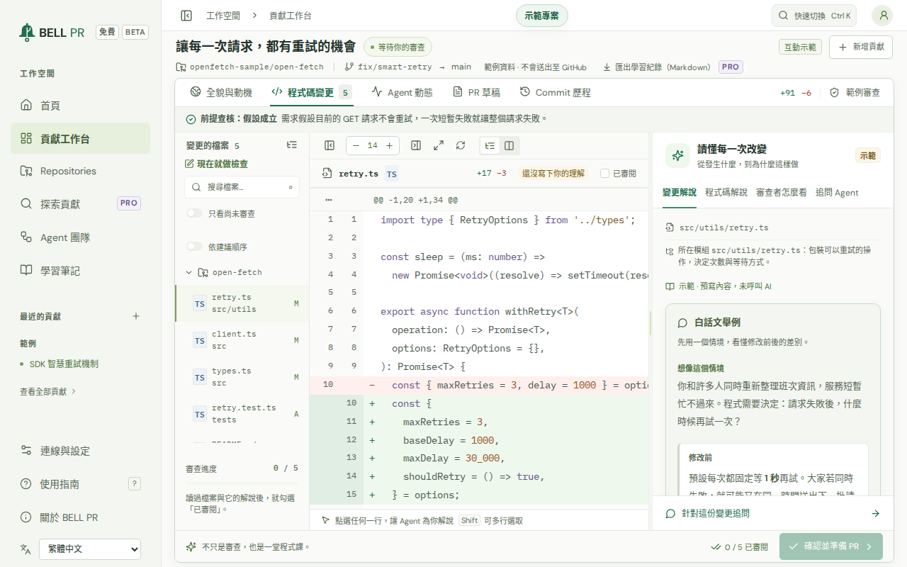
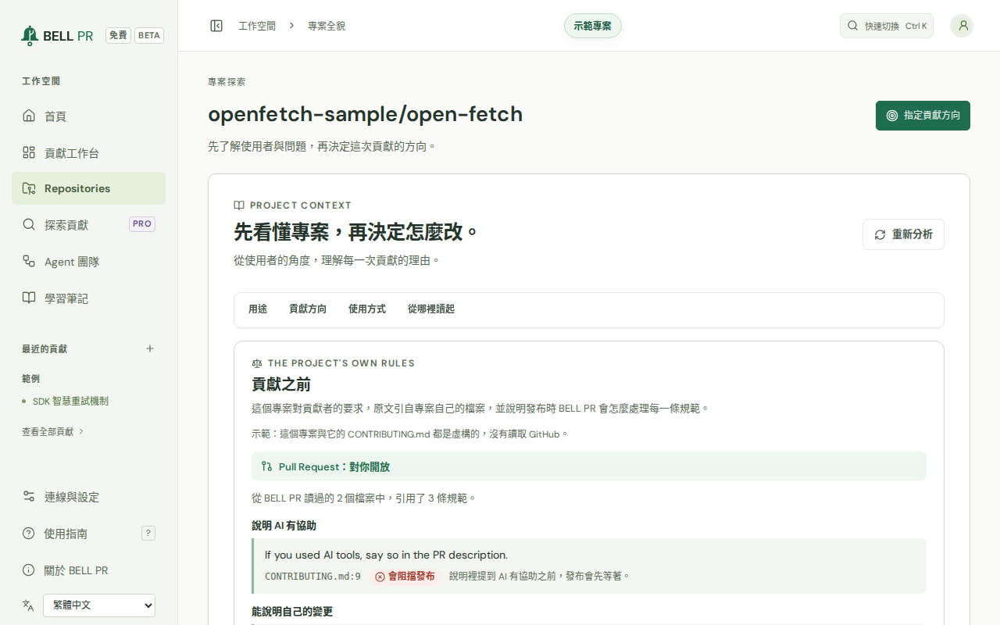
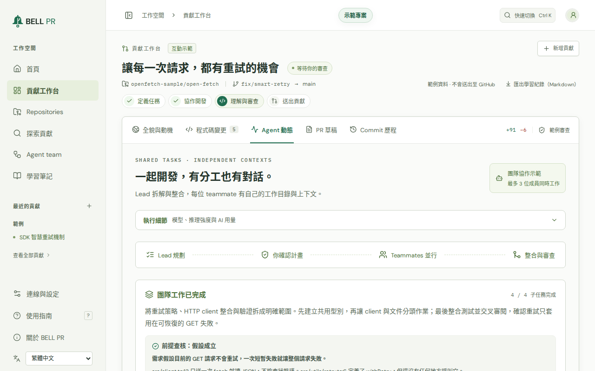
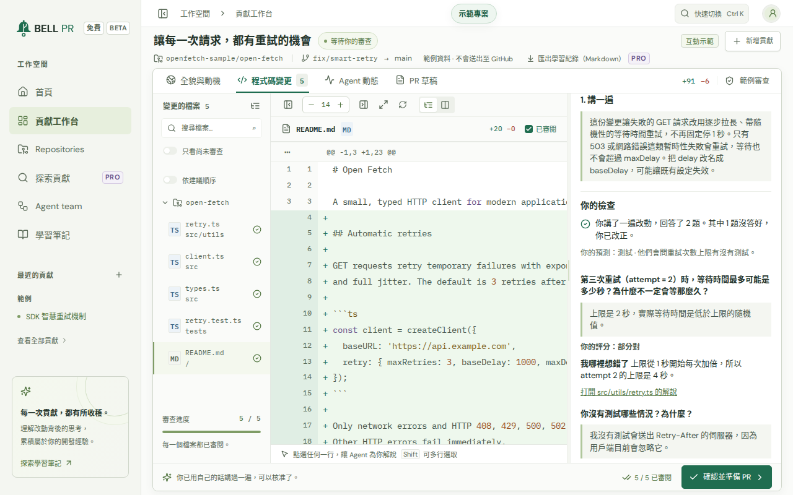
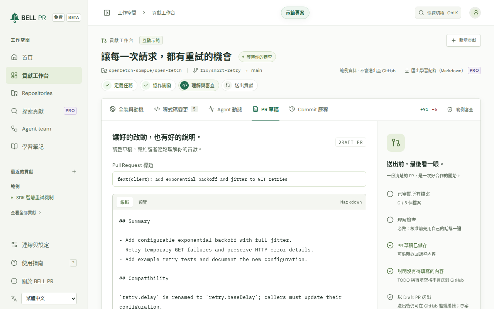
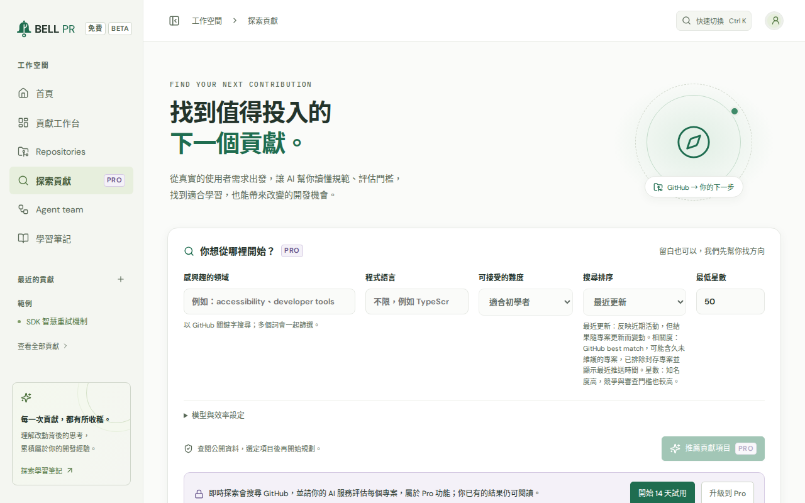
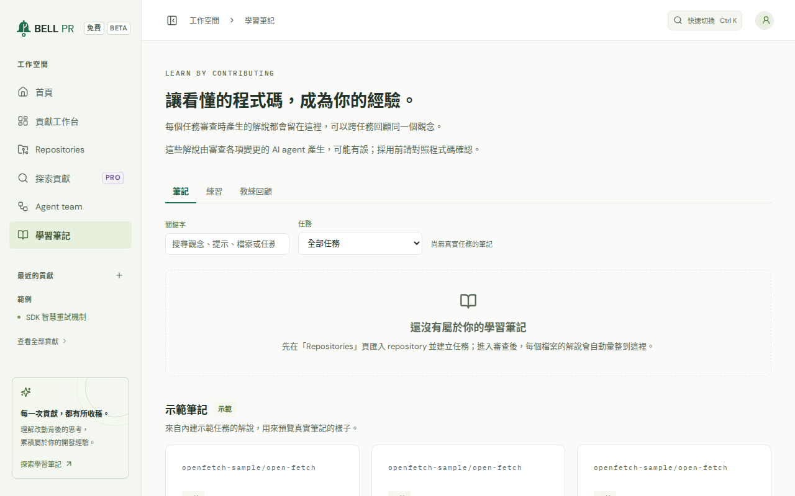

# BELL PR

**從「憑感覺寫」到「知道為什麼」。**

AI Agent 團隊負責跑腿；你理解每一處改動、用自己的話講一遍，只送出維護者樂意審閱的 PR。

[English](README.md) · 繁體中文

BELL PR 是自架、以本機為主的開源貢獻工作台。它在你的電腦上執行，搭配你已在使用的 AI 程式設計 CLI（OpenAI Codex CLI 或 Claude Code）與 GitHub CLI：先分析專案、建議可以貢獻的方向，再讓一支小型 Agent 團隊在獨立的 Git worktree 中完成修改。接著，它讓你做真正讓自己進步的那部分：理解你送出的每一行、在真實的程式碼裡練出品味，並尊重維護者的時間。它用白話解說每一個變更的檔案，在你核准前請你用自己的話把改動講一遍，並依照該專案自己的規範擬好 Pull Request 草稿。送出之前，它會確認專案接受你的 PR、issue 仍然開著而且沒人在做，以及改動審得完、測試也誠實。

**邊貢獻邊學習，絕不是自動產生 PR。** 在你逐一審閱每個檔案、用自己的話把改動講一遍（預設開啟；你可以關閉，而工作會標示出來），並親自核准 Pull Request 之前，不會發佈任何內容。發佈時會確認專案歡迎這個 PR。沒有 BELL PR 雲端服務、沒有遙測，也不需要帳號。



[快速開始](#快速開始) · [系統需求](#系統需求) · [功能](#功能) · [免費版與 Pro](#免費版與-pro) · [隱私](#隱私) · [安全模型](#安全模型) · [設定](#設定) · [疑難排解](#疑難排解) · [文件](#文件)

## 快速開始

[系統需求](#系統需求)都準備好之後，大約 60 秒就能開始。

1. 啟動 BELL PR：

   ```sh
   npx bell-pr
   ```

2. 它會印出登入連結，並在瀏覽器中開啟已登入的 BELL PR：

   ```text
   BELL PR 1.0.0-rc.1 → http://127.0.0.1:4311/auth?t=…
   ```

3. 依照歡迎畫面完成設定：選擇**語言**、接受**授權條款**、檢查**工作環境**（缺少的工具都會附上修正指令），再選擇 Agent 使用的 **AI 服務**。
4. 觀看範例導覽、匯入 Repository，或尋找想貢獻的專案。

**登入連結不見了？執行 `bell-pr open`**（若用 `npx` 啟動，請執行 `npx bell-pr open`）。它會開啟一個新的一次性連結。

想要保留安裝，請執行 `npm install -g bell-pr`，之後用 `bell-pr` 啟動。[入門指南](docs/getting-started.md)（英文）會帶你走完一次完整的貢獻。

## 系統需求

- **Node.js 22 以上。**
- **Git。** 把工作同步到最新的目標分支需要 Git 2.40 以上；提交前需要在 Git 設定你的名字與電子郵件地址。
- **GitHub CLI**（`gh`），並以 `gh auth login` 登入，用於從 GitHub 匯入、發佈 Pull Request 與尋找專案。
- **Codex CLI 或 Claude Code**，以執行 BELL PR 的同一個使用者安裝並登入。兩者擇一即可。
  - Codex CLI：`npm install -g @openai/codex`，再執行 `codex login`。使用你已安裝並登入的 Codex CLI，用量計入你自己的帳戶。
  - Claude Code：`npm install -g @anthropic-ai/claude-code`，再執行 `claude auth login`。使用你已安裝並登入的 Claude Code CLI（Claude 方案或 Anthropic API 金鑰），用量計入你自己的帳戶。
- **Linux 需要 bubblewrap 與 socat**，Claude Code Agent 才能在沙箱中修改檔案（`sudo apt-get install bubblewrap socat`）。

`bell-pr doctor` 會檢查以上所有項目，並為每個問題印出修正指令。

## 支援平台

- **macOS**
- **Linux**
- **Windows（透過 WSL2）**：請在 WSL 發行版中安裝並執行 BELL PR、Git、GitHub CLI 與你的 AI CLI。

1.0.0-rc.1 候選版本已在 Linux 上驗證；macOS 與 WSL2 的驗證仍在進行中（請見[變更紀錄](CHANGELOG.md)）。另有 Docker 映像檔，目前為 beta。

## 功能

### 修改之前，先理解專案

Agent 以唯讀方式閱讀專案，說明它的用途、使用者、各部分如何搭配，以及該從哪裡開始讀。它最多建議五個貢獻方向，每個方向都引用所依據的程式碼或文件原文，BELL PR 會逐一確認這些引文確實存在。同一頁的「**貢獻之前**」卡片會引用專案自己的貢獻規範（請見[尊重維護者的時間](#尊重維護者的時間)）。



### 小型 Agent 團隊，各自在獨立的 worktree 工作

你描述這次貢獻：誰會受益、對他們有什麼改變、哪些行為不能改變、怎樣才算完成。**Lead** 把工作拆成檔案範圍明確的任務，你可以確認計畫或退回並補充意見。**Teammates** 各自在自己的 Git worktree 中平行工作，透過團隊收件匣分享發現；它們被要求只改自己範圍內的檔案、不做純格式的修改，也絕不削弱、略過或刪除測試。整合之後，**Reviewer** 與 **Test analyst** 會檢查結果，各自只補充 Lead 摘要沒說到的部分。失敗的子任務可以重試。

規劃之前，Lead 會對照程式碼查核需求裡寫下的假設，並把結論告訴每個角色；任務簡介會顯示結論；工作完成後可以重新查核，在有這項查核之前建立的工作也能補做。Agent 被要求不改動你的電腦：不用 `sudo`，也不做全域安裝。檢查需要這台電腦缺少的環境時，全貌頁會列出它與建議的安裝指令，由你確認後自行執行。



### 會教你、也確認你學會的審閱

每個變更的檔案都附有白話解說：修改前後行為的具體例子、改了什麼與為什麼、相關觀念、審閱時要注意什麼、另一種可行做法，以及一題考考自己。**先試著答**：在答案出現之前，你先回答這題並選擇有多確定，再自己評分；在另一種做法出現之前，你也可以先猜猜還能怎麼改，再選擇在這個專案裡你會採用哪一種、為什麼。點選任一行就能請 Agent 解說，可依建議順序閱讀、寫下自己的筆記，逐檔標記為已審閱，然後在核准前用自己的話把改動講一遍。你也可以自己修改程式碼，再重新整理差異。

diff 可以展開每段變更周圍未變更的程式碼，一次 20 行或整個檔案。「**程式碼解說**」會逐步說明每段變更所在的函式、在 diff 中標出對應的行，並列出誰呼叫它、它又呼叫了誰；整段新增的函式則指回變更解說，不重複說明。

**只送出你講得清楚的程式碼。** 核准之前，diff 旁邊會開啟一個簡短的閉卷檢查：用幾句自己的話說明這次改動、回答關於風險最高的檔案最多三個問題（很小的改動不會有題目），有原始碼變更時再說明你沒測試什麼。接著把每個答案和 AI 寫的參考答案並排對照、自己評分，並修正答錯的地方。不會有 AI 模型替你評分，這個檢查也不會呼叫 AI。理解檢查預設開啟，而且免費。你可以在**設定 → 學習**關閉它：每個檔案仍然必須審閱、你仍然要親自核准 Pull Request，而未經檢查就核准的工作會永久標示「理解檢查已關閉」。



### 遵循專案規範的 Pull Request

BELL PR 會閱讀專案的貢獻指南、AI 政策、PR 範本、Agent 指南與檢查 PR 的 workflow，建議標題、說明與提交訊息，並標出每條規則的來源。你自己的說明可以作為描述的開頭：按「**使用我的說明**」就能放進去，「**把我沒測試的部分加到 Testing**」則會補上你沒測試的部分。描述仍是 BELL PR 建議的文字時，發佈前會請你確認；如果專案要求用貢獻者自己的話撰寫，則會等你改寫後才發佈。可審查性快照會把這次改動的大小和專案最近合併的 PR 並列；被略過、刪除或放寬的測試，發佈前都需要一行理由。

送出前會檢查內容：憑證與尚未填寫的待填標記會擋下送出，本機路徑、CI 設定變更與會公開的提交電子郵件地址則需要你確認。只有專案要求或你自己選擇時，才會註明 AI 協助；專案要求揭露時，在揭露寫好之前不會發佈。發佈時會推送分支（必要時推到你的 fork），並透過 GitHub CLI 開啟 **Draft** PR；絕不會 force push。



### 尊重維護者的時間

任何東西都可以在本機練習；只發佈受歡迎的 PR。

- **貢獻之前。** 專案全貌會從專案自己的檔案引用它的規範，並附上檔案與行號：對 AI 協助貢獻的規定、揭露 AI 協助、用自己的話撰寫描述、說明自己的改動、留給新手的 issue、寫給 AI Agent 的說明，以及先開 issue 的要求。它也會顯示這個專案是否接受你的 PR。BELL PR 絕不會說一個專案沒有規範，只會說它讀了哪些檔案。
- **issue 仍然開著、仍然是你的。** 連結 issue 後，任務對話框會顯示它是否仍然開著、是否已指派給別人或有人認領、是否已有別人的 PR 會關閉它，以及維護者最近在那裡說了什麼。這些都不會阻止你開始與練習；發佈時會再檢查一次。
- **先把上一個 PR 處理完，再開下一個。** BELL PR 會計算你在這個 repository 中尚未關閉的 PR。在你第一個 PR 被合併之前，額度是 1 個，之後是 2 個：達到額度時，發佈前會請你確認；維護者等你回覆 review 超過 7 天時也會；達到額度的兩倍時，則要等你完成或關閉其中一個才能發佈。這些數字是 BELL PR 的預設值，所有方案都相同。你有寫入權限的 repository 不受限制，本機的工作也永遠不受限制。
- **發佈時再檢查一次。** 發佈時會再從 GitHub 讀取這些事實。專案不接受你的 PR、規範不接受 AI 協助的貢獻、issue 已關閉、issue 是專案留給新手的，以及達到額度的兩倍，都會擋下發佈，而且無法略過；別人已有會關閉同一個 issue 的開啟中 PR 時，要等你寫下理由才能發佈。BELL PR 讀不到的事實會顯示「無法確認」，絕不會當成通過。

[負責任地貢獻](docs/contributing-responsibly.md)（英文）用維護者自己的話說明他們要求什麼，以及每一項檢查如何對應。

### 發佈之後

可以把工作或它的 Pull Request 同步到最新的目標分支，並讓 Agent 解決衝突供你審閱。所有方案都可以按「**讀取回饋**」，在你要求時讀取一次維護者的 review、留言與 CI 結果：把它們和你的預測對照，並標記每則意見談的是什麼、你是否料到。Pro 還能讓 Agent 依你選取的意見進行一輪修正，前提是你先用自己的話重述每一則意見；經你審閱後，以一個新的 commit 推送。「**Commit 歷程**」列出 Pull Request 的每個 commit，從第一次推送到修正輪、同步與在 GitHub 上做的提交，每個都能展開看各檔的 diff。

### 找到下一個貢獻（Pro）

探索功能會在 GitHub 上搜尋符合你的興趣、程式語言與想挑戰難度的專案與 issue，閱讀它們的貢獻規範，並說明工作量與第一步。它為 Agent 團隊尋找 help wanted 的 issue；標示給新手的 issue 會標上「親手學」，因為親自寫出那個修正，正是新手認識專案的方式。免費版顯示標示清楚的範例結果。



### 學習頁與練習

所有貢獻的解說與筆記都集中在同一頁，並可搜尋，方便日後回顧某個觀念。「**練習**」會在 1、3、7、21 天後把你自己的題目帶回來：你有把握卻答錯的答案、讓你意外的維護者意見，以及你從沒試過的題目。來自你紀錄的簡單統計（例如你說「確定」時答對幾次）會在累積足夠時才出現，而且都不是分數或目標。Pro 的**教練回顧**會讀取你在某個專案的紀錄，指出維護者最常提出的面向，並從你自己的貢獻出題做練習；Pro 也能把一次貢獻的完整學習紀錄匯出為 Markdown。



### 你的工具、你的帳號、你的語言

選擇 Codex CLI 或 Claude Code、模型與思考強度，以及效率模式（輕量、完整或關閉）。每個工作都會顯示服務商回報的用量。CLI 失敗時會先顯示它回報的錯誤，原始輸出則收合起來。介面與 Agent 的解說可以使用英文或繁體中文（台灣）；除非專案另有要求，Pull Request 一律使用英文。

### 用範例專案試試看

範例專案是一次已完成的貢獻，包含專案的規範、計畫、變更、解說、理解檢查與 PR 草稿，不需任何設定，也不會呼叫 AI。它也會用範例資料展示 Pro 功能。

## 免費版與 Pro

<!-- generated:plan-table locale=zh-TW -->

| 功能 | 方案 | 限制 |
| --- | --- | --- |
| Repository 與貢獻工作 | 免費 | Repository 與工作數量不限 |
| 專案分析與經驗證的建議 | 免費 | 每次分析最多 5 個建議，可重新分析。降級後，已產生的建議（最多 30 個）仍會保留。 |
| 更多建議（「產出 5 個新建議」，每個專案最多 30 個） | Pro | 免費：5 個。Pro：每個專案最多 30 個。 |
| Agent 團隊規模 | 免費（有限制） | 免費：Lead、2 位隊友、Reviewer 與 Test analyst。Pro 與試用：3 或 4 位隊友。 |
| 同時進行多項貢獻 | 免費（有限制） | 免費：一次進行一項貢獻，其餘依序排隊。Pro：依你的設定同時進行（預設 2 項，最多 8 項）。所有方案的發布節奏都相同。 |
| 計畫核准與修訂、團隊收件匣、重試失敗的子任務 | 免費 | 計畫最多修訂 3 次 |
| 差異審查、解說、先試著答的提問、追問對話、筆記與建議審查順序 | 免費 | 不限 |
| 核准前用自己的話講一遍 | 免費 | 預設開啟；可在「設定 → 學習」關閉，未經檢查就核准的工作會被標記 |
| 重新執行 Reviewer 與 Test analyst | 免費 | 不限（屬於人工審查的安全關卡） |
| 程式碼解說、變更周圍未修改的程式碼、前提查核、Commit 歷程與環境設定指引 | 免費 | 不限 |
| 依專案規範撰寫 PR 草稿、送出前檢查、發布 Draft PR | 免費 | 所有方案都必須經過人工核准 |
| 專案規範、issue、可審查性與發布節奏檢查 | 免費 | 所有方案都有；任何方案都無法略過 |
| 將工作同步到目標分支的最新版本、由 Agent 解決衝突、更新專案的本機 clone | 免費 | 不限（未發布的工作與已發布的 PR 皆可） |
| 學習筆記頁面 | 免費 | 不限 |
| 練習卡組與學習統計 | 免費 | 不限 |
| 匯出完整學習紀錄（Markdown） | Pro | 免費：不提供（學習頁面仍免費） |
| 依你自己的紀錄產生教練回顧 | Pro | 免費：不提供；範例專案會顯示標示 PRO 的範例。降級後，已有的回顧仍可查看。 |
| 讀取維護者回饋，並與你的預測對照 | 免費 | 不限 |
| 針對維護者回饋的 AI 後續修改回合 | Pro | 免費：不提供。降級後，工作上已有的後續修改回合仍可查看，進行中的回合仍可審查、推送、停止或捨棄。 |
| 探索貢獻（全 GitHub 推薦） | Pro | 免費：僅提供標示為範例的結果。既有結果仍可查看，進行中的探索仍可取消。 |
| Agent 網路存取 | Pro | 免費：關閉。Pro：預設關閉，由你自行開啟。開啟後，Claude Code 只能開啟 GitHub 自家網站的頁面；Codex CLI 使用 OpenAI 的網路搜尋。 |
| 深度思考強度（xhigh、max、ultra） | Pro | 免費：可選 none 到 high。思考強度維持「模型預設」時，所有方案都使用模型本身的預設強度。 |
| Provider、模型選擇、效率模式 | 免費 | Codex CLI 與 Claude Code、所有模型、所有效率模式 |
| 範例專案／示範（以範例資料展示 Pro 功能） | 免費 | 僅在瀏覽器中使用範例資料 |
| 14 天 Pro 試用 | 免費 | 每個資料目錄一次，只在你選擇時開始（在 App 中或使用 bell-pr license trial） |
| Pro 授權期限與更新 | Pro | 授權給指定使用者；永久授權，自金鑰核發日起享有 12 個月的更新 |

<!-- /generated:plan-table -->

免費版涵蓋完整、負責任的貢獻流程；Pro 讓你走得更深：教練回顧、完整學習紀錄、AI 後續修改回合、更大的團隊、同時進行多項貢獻、探索、網路存取與深度思考。沒有任何方案能買到更多 PR，或略過任何一項檢查。

每個資料目錄都可以試用 Pro 14 天：在**設定 → 授權**按「開始 14 天試用」，或執行 `bell-pr license trial`。回到免費版也不會拿走你已經有的工作、筆記或結果。請見[授權說明](docs/licensing.md)（英文）。

<!-- generated:product-link key=pricingUrl text="價格" -->
<!-- /generated:product-link -->
<!-- generated:product-link key=purchaseUrl text="購買 Pro" -->
<!-- /generated:product-link -->

## 隱私

- BELL PR 在你的電腦上執行，所有資料都放在同一個資料目錄。沒有 BELL PR 雲端、帳號、遙測、分析或授權伺服器。
- 你的程式碼與提問只會送到你自己設定的服務：你選擇的 AI CLI 背後的服務商，以及 GitHub，都使用你自己的帳號。
- Agent 的網路存取預設關閉，只有你開啟時才會使用（Pro）。
- 你可以在應用程式中釋放某個工作的檔案、刪除工作或專案，或刪除所有資料。

詳情請見[隱私與資料](docs/privacy-and-data.md)（英文）與 [PRIVACY.md](PRIVACY.md) 的隱私權政策。

## 安全模型

- **在沙箱中執行的 Agent。** 會寫程式的 Agent 在各自 CLI 的作業系統沙箱中執行：寫入限制在該工作自己的 worktree，網路也會關閉。Claude Code Agent 另外無法讀取你的 SSH 金鑰、GitHub CLI 的登入資訊與 BELL PR 自己的資料；Codex 的沙箱則不限制讀取。
- **匯入的專案不受信任。** 專案的程式碼、文件與 Agent 指示（`AGENTS.md`、`CLAUDE.md`、`.claude/`）都只被當成資料：CLI 不會載入專案自己的設定、hooks 或指示；Git 設定可能執行其他程式的 repository 會被拒絕。Agent 仍會執行專案的程式碼，請只匯入你願意在這台電腦上執行的專案。
- **工作階段登入。** BELL PR 在 `127.0.0.1` 上監聽，瀏覽器必須開啟登入連結後才會被接受。工作階段的密鑰只存在記憶體中，所以重新啟動會讓所有人登出。來自其他網站的請求一律拒絕。
- **在沙箱外執行必須明確開啟。** 沒有沙箱時（例如使用預設設定的 Docker），會修改檔案的 Claude Code Agent 會被拒絕。你可以在**設定 → Agent 安全**或用 `BELLPR_ALLOW_UNSANDBOXED_AGENTS=1` 允許；這類 Agent 擁有你完整的使用者權限，用過它的每個工作都會顯示「**未使用沙箱執行**」標記。
- **由你發佈。** 在你逐檔審閱並核准之前，不會有任何內容送到 GitHub，而且 commit 只包含你審閱過的檔案。

詳情與限制請見[安全模型](docs/security-model.md)（英文）。回報安全性漏洞請見 [SECURITY.md](SECURITY.md)。

## 設定

BELL PR 不需要任何設定就能啟動。下列設定都是啟動時讀取的環境變數；`bell-pr start` 另外接受 `--port`、`--host`、`--data-dir`、`--no-open` 與 `--env-file <file>`。在應用程式「設定」中調整的值，除非被環境變數指定，否則都會生效。

| 變數 | 預設值 | 用途 |
| --- | --- | --- |
| `BELLPR_PORT` | `4311` | 網頁介面與 API 的埠（1024 到 65535） |
| `BELLPR_HOST` | `127.0.0.1` | 監聽的位址；若要從其他電腦連線，請保留預設值，改用 HTTPS 反向代理並設定 `BELLPR_PUBLIC_URL` |
| `BELLPR_PUBLIC_URL` | 無 | 在反向代理或其他對外埠之後時，瀏覽器使用的網址 |
| `BELLPR_ALLOWED_ORIGINS` | 無 | 額外接受的精確 origin，以逗號分隔 |
| `BELLPR_DATA_DIR` | `~/.bellpr` | 資料目錄 |
| `BELLPR_NO_OPEN` | 未設定 | `1` 表示絕不開啟瀏覽器 |
| `BELLPR_LOCALE` | `en` | 伺服器與 CLI 訊息的預設語言（`en` 或 `zh-TW`） |
| `BELLPR_LOG_LEVEL` | `info` | `debug`、`info`、`warn` 或 `error` |
| `BELLPR_LICENSE_KEY` | 無 | Pro 授權金鑰；優先於已儲存的金鑰 |
| `BELLPR_MAX_AGENT_PROCESSES` | `3` | 同時執行的 Agent CLI 行程數（1 到 32） |
| `BELLPR_MAX_ACTIVE_RUNS` | `2` | 同時執行的貢獻工作數（1 到 8；免費版一次一個） |
| `BELLPR_AGENT_TIMEOUT_SCALE` | `1` | Agent 逾時時間的倍率（0.5 到 10） |
| `BELLPR_ALLOW_UNSANDBOXED_AGENTS` | 未設定 | `1` 允許 Claude Code Agent 在沙箱外修改檔案 |
| `BELLPR_REQUIRE_UNDERSTANDING_CHECK` | 未設定 | `1` 保持理解檢查開啟並鎖定這項設定；沒有任何值能關閉它 |
| `BELLPR_RETENTION_DAYS` | `14` | 已取消與失敗工作的檔案保留天數（1 到 365） |
| `BELLPR_DEV` | 未設定 | 開發模式，只用於開發 BELL PR 本身 |
| `BELLPR_FRONTEND_PORT` | `4310` | 開發模式信任的開發伺服器埠 |
| `BELLPR_STATIC_DIR` | 套件的 `dist/` | 要提供的已建置網頁介面 |

每個變數、指令與應用程式設定的說明請見[設定說明](docs/configuration.md)（英文）；[.env.example](.env.example) 是附註解的範本。只用於 BELL PR 自身測試的變數列在[開發說明](docs/development.md#test-and-tool-variables)（英文）。

## Docker（beta）

```sh
docker build -t bell-pr .
docker run -d --name bell-pr -p 127.0.0.1:4311:4311 \
  -v bellpr-data:/data -v bellpr-home:/home/node bell-pr
docker exec bell-pr bell-pr open --print
```

映像檔包含 Git、GitHub CLI 與 Codex CLI；Claude Code 可以由你自行安裝到容器中。Docker 目前為 **beta**：Agent 的沙箱需要另外三個 `--security-opt` 選項。使用前請先閱讀 [Docker 說明](docs/docker.md)（英文）；若要以 systemd 服務執行或放在反向代理之後，請見[自架說明](docs/self-hosting.md)（英文）。

## 疑難排解

```sh
bell-pr doctor
```

會檢查 Node.js、Git、GitHub CLI 與其權限、Agent CLI 與其登入狀態、Claude Code 沙箱以及資料目錄，並為每個問題印出修正指令。`bell-pr doctor --json` 以 JSON 輸出同一份報告。所有必要檢查都通過時，結束代碼為 0。

[疑難排解](docs/troubleshooting.md)（英文）列出[每個錯誤代碼](docs/troubleshooting.md#error-codes)與修正方式、說明 [BELL PR 為什麼擋下發佈](docs/troubleshooting.md#publishing-was-blocked-by-a-project-rule-an-issue-or-pacing)、BELL PR 無法啟動時該怎麼辦，以及如何收集支援所需的資訊。

## 資料目錄與備份

BELL PR 把所有資料放在 `~/.bellpr`（或 `--data-dir`／`BELLPR_DATA_DIR` 指定的目錄）：`state.json` 中的專案與工作、它自己的專案 clone、每個工作的 Git worktree、分析結果、設定、授權與記錄檔。只有你的使用者可以讀取。

- **備份**時請先停止 BELL PR，再複製整個目錄。請還原到相同路徑：裡面的紀錄包含絕對路徑。
- BELL PR 會保留 `state.json` 的最近三個版本，檔案損壞時會自動復原。
- 同一個資料目錄一次只能有一個 BELL PR 執行。
- **升級**不會搬動你的資料，而且從 1.0.0 起，舊版本仍能讀取新版本寫入的資料。請見[升級說明](docs/upgrading.md)（英文），其中也說明 1.0 之前版本的資料。

## 授權與啟用

Pro 以授權金鑰解鎖，BELL PR 會在本機離線檢查金鑰。啟用方式有三種：

- **在應用程式中：** 到**設定 → 授權**貼上金鑰，按「啟用」。
- **在命令列：** `bell-pr license activate <key>`，或 `bell-pr license activate -` 從標準輸入讀取。`bell-pr license status` 顯示方案；`deactivate` 移除金鑰；`trial` 開始 14 天試用。
- **使用環境變數：** `BELLPR_LICENSE_KEY=<key>`；優先於已儲存的金鑰。

金鑰涵蓋在更新期限內（預設為自金鑰核發日起 12 個月）發佈的版本，並可永久用於這些版本。這個候選版本中還沒有任何授權金鑰能解鎖 Pro；試用可以使用。請見[授權說明](docs/licensing.md)（英文）。

## 文件

文件目前只有英文版。

- [入門指南](docs/getting-started.md)
- [設定說明](docs/configuration.md)
- [疑難排解](docs/troubleshooting.md)
- [授權說明](docs/licensing.md)
- [負責任地貢獻](docs/contributing-responsibly.md)
- [隱私與資料](docs/privacy-and-data.md)
- [升級說明](docs/upgrading.md)
- [常見問題](docs/faq.md)
- [自架說明](docs/self-hosting.md)與 [Docker 說明](docs/docker.md)
- [安全模型](docs/security-model.md)
- [開發說明](docs/development.md)：從原始碼建置與檢查 BELL PR
- [變更紀錄](CHANGELOG.md)

<!-- generated:product-link key=docsUrl text="線上文件" -->
<!-- /generated:product-link -->

## 支援與聯絡

請先執行 `bell-pr doctor` 並查看[疑難排解](docs/troubleshooting.md)。「關於」對話框（**設定 → 關於 → 關於 BELL PR**）可以複製一份診斷資訊，其中的密鑰、路徑與你的 GitHub 帳號都已移除，可以直接貼到支援請求中。

<!-- generated:product-link key=homepageUrl text="網站" -->
<!-- /generated:product-link -->
<!-- generated:product-link key=supportEmail text="以電子郵件聯絡支援" -->
<!-- /generated:product-link -->
<!-- generated:product-link key=publicRepoUrl path=issues text="回報問題" -->
<!-- /generated:product-link -->
<!-- generated:product-link key=securityEmail text="私下回報安全性問題" -->
<!-- /generated:product-link -->

## 授權條款與商標

BELL PR 依 [LICENSE.md](LICENSE.md) 中的終端使用者授權合約授權使用。BELL PR 包含的第三方軟體列於 [THIRD_PARTY_NOTICES.md](THIRD_PARTY_NOTICES.md)。這個候選版本的法律文件仍是草稿，尚待律師審閱。

BELL PR 是獨立產品，與 GitHub, Inc.、OpenAI 及 Anthropic PBC 皆無關聯，也未獲其認可或贊助。GitHub、OpenAI、Codex、Anthropic、Claude 與 Claude Code 均為其各自擁有者的商標；BELL PR 提及這些名稱，僅為說明可搭配使用的工具。
